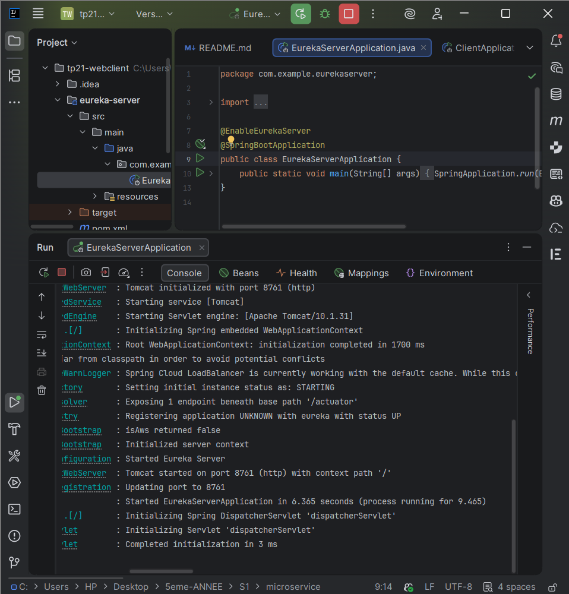
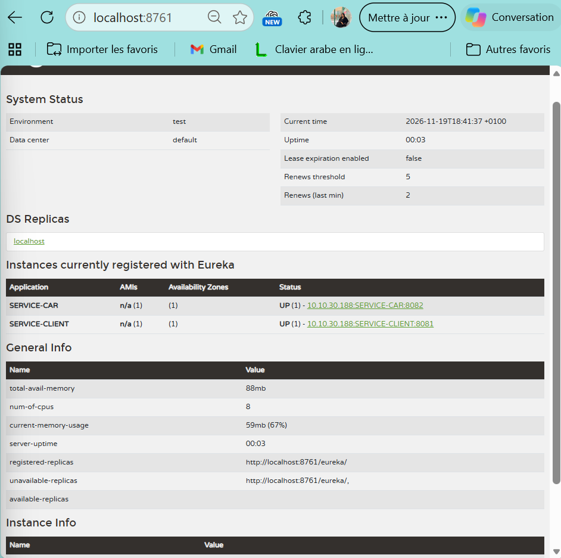
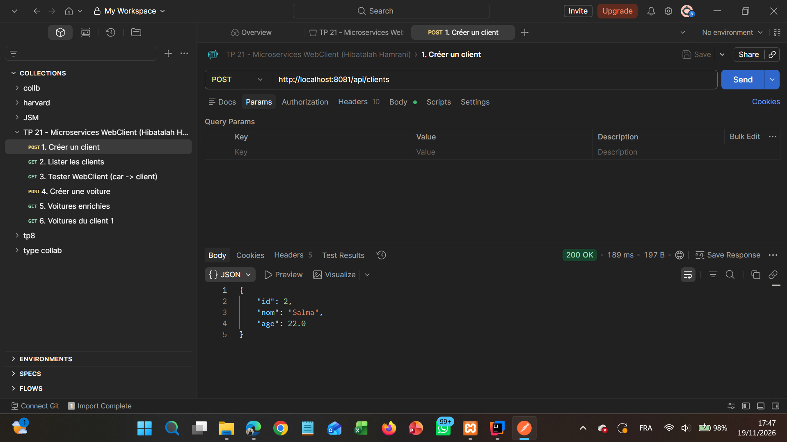
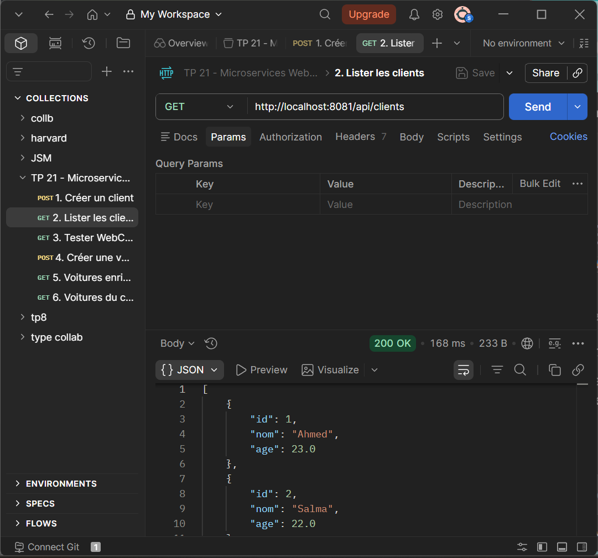
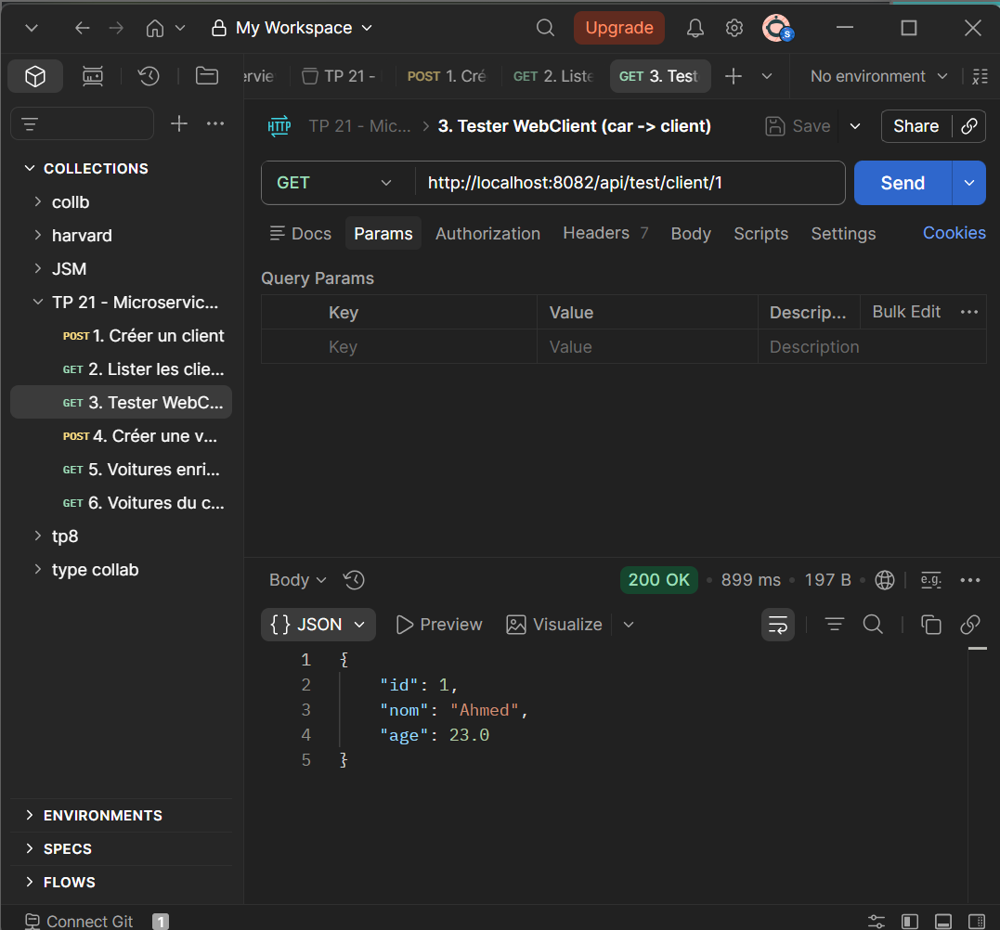
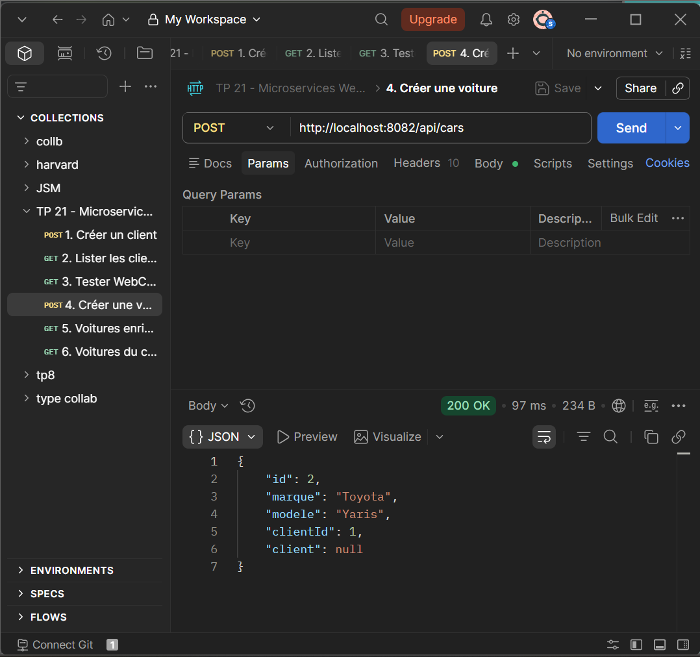
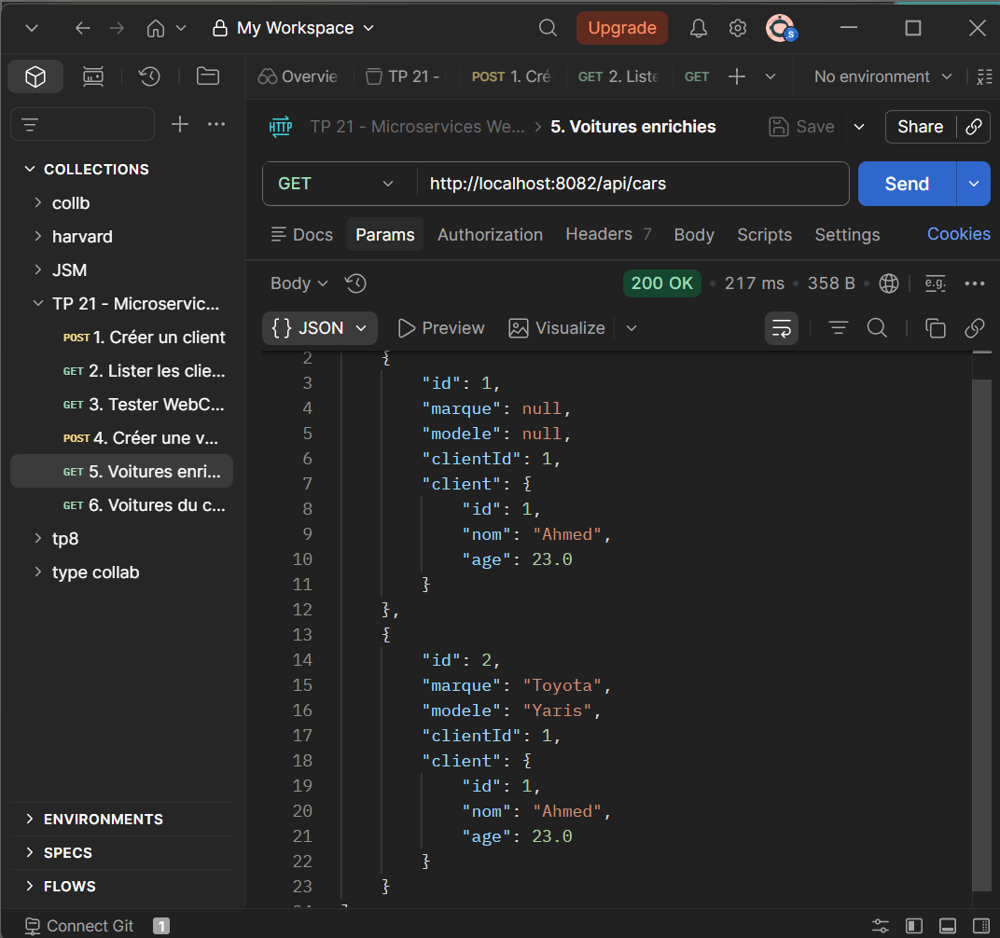
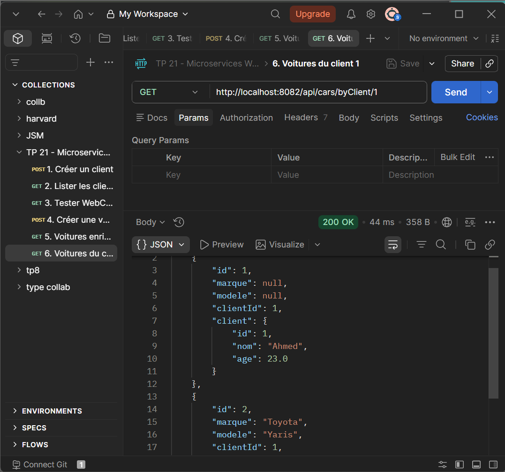

# TP 21 : Architecture Micro-services avec WebClient

**Auteur : Hibatalah Hamrani** - EMSI Marrakech, cours *Architecture Microservices : Conception, Déploiement et Orchestration*

Trois microservices Spring Boot :

| Projet | Port | Rôle |
|---|---|---|
| `eureka-server` | 8761 | Serveur de découverte (registre Eureka) |
| `service-client` | 8081 | CRUD des clients (MySQL `clientservicedb`) |
| `service-car` | 8082 | CRUD des voitures (MySQL `carservicedb`) + appel à `SERVICE-CLIENT` via **WebClient** |

```
                 ┌──────────────────────┐
                 │  eureka-server :8761  │
                 └──────────▲───────────┘
            enregistrement  │  enregistrement
        ┌───────────────────┴───────────────────┐
┌───────┴────────┐   WebClient @LoadBalanced  ┌──┴──────────────┐
│ service-car    │ ─────────────────────────▶ │ service-client  │
│ :8082          │  http://SERVICE-CLIENT/... │ :8081           │
└───────┬────────┘                            └───────┬─────────┘
   carservicedb                                clientservicedb
```

## Stack
Java 17, Spring Boot 3.3.5, Spring Cloud 2023.0.3 (Netflix Eureka, LoadBalancer), Spring Data JPA, Spring WebFlux (WebClient), MySQL.

## Lancement
Prérequis : MySQL démarré sur `localhost:3306`, utilisateur `root` (mot de passe à adapter dans les `application.yml`).

Ordre de lancement :
1. `eureka-server` → http://localhost:8761
2. `service-client` (8081)
3. `service-car` (8082)

Le dashboard Eureka doit afficher **SERVICE-CLIENT** et **SERVICE-CAR**.

## Endpoints

| Méthode | URL | Description |
|---|---|---|
| POST | `http://localhost:8081/api/clients` | Créer un client |
| GET | `http://localhost:8081/api/clients` | Lister les clients |
| GET | `http://localhost:8082/api/test/client/{id}` | Test WebClient (service-car → service-client) |
| POST | `http://localhost:8082/api/cars` | Créer une voiture |
| GET | `http://localhost:8082/api/cars` | Voitures enrichies avec leur client |
| GET | `http://localhost:8082/api/cars/byClient/{clientId}` | Voitures d'un client |

## Points clés
- **`@LoadBalanced` sur `WebClient.Builder`** : permet d'appeler `http://SERVICE-CLIENT/...` par le nom Eureka (sinon : `No instances available for SERVICE-CLIENT`).
- **Pas de relation JPA entre services** : chaque service a sa propre base, donc `Car` stocke seulement `clientId` et le client est ajouté à la réponse par un appel HTTP (champ `@Transient`).
- **`block()`** : choisi pour la simplicité du TP. En production, on garderait le flux réactif (`Mono`/`Flux`).

## Captures

### 1. Démarrage d'Eureka Server (port 8761)


### 2. Dashboard Eureka : SERVICE-CLIENT et SERVICE-CAR enregistrés (UP)


### 3. Création d'un client (`POST /api/clients`)


### 4. Liste des clients (`GET /api/clients`)


### 5. Test WebClient : service-car appelle SERVICE-CLIENT (`GET /api/test/client/1`)


### 6. Création d'une voiture liée au client 1 (`POST /api/cars`)
`client` vaut `null` dans la réponse du POST : la voiture est seulement enregistrée, l'enrichissement se fait à la lecture.



### 7. Voitures enrichies avec leur client (`GET /api/cars`)


### 8. Voitures d'un client (`GET /api/cars/byClient/1`)
